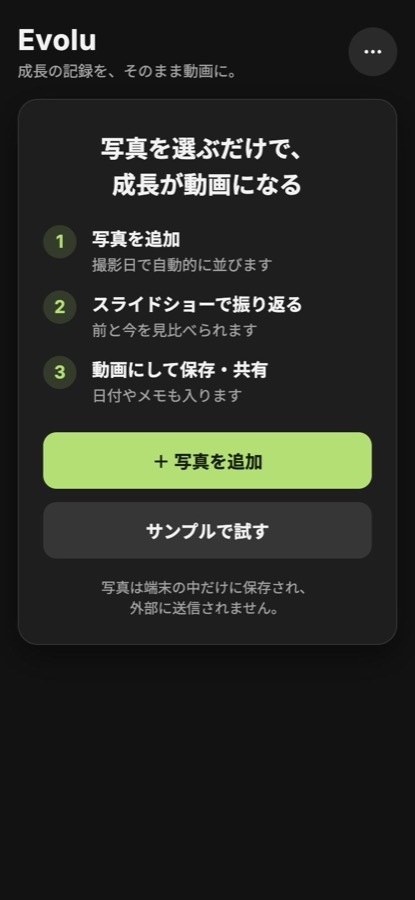
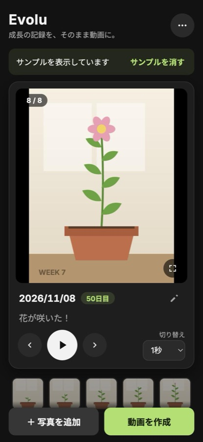

# Evolu - 成長過程観察・記録アプリ

## 概要
Evolu（エボル）は、日々の変化や成長過程を「ビフォーアフター」として観察・記録することに特化したWebアプリケーションです。
ユーザーの大切な画像データを外部サーバーに送信せず、端末内に安全に保存するプライバシーファーストな設計を採用しています。

## アプリケーションURL
https://evolu-rec.vercel.app

写真がなくても、最初の画面の「サンプルで試す」から、スライドショーと動画の作成まで体験できます。

<p>
  
  
</p>

## 主な機能
* **画像のローカル保存機能**
  * 撮影・選択した画像をIndexedDBを用いてブラウザ内に直接保存します。
* **ビフォーアフター比較機能**
  * スライドショー形式で過去の記録と現在の状態を直感的に比較できます。
  * サムネイル一覧やスワイプで記録を行き来でき、日付とメモは後から編集できます。
* **撮影日の自動取得**
  * 写真のEXIF情報から撮影日を読み取り、時系列に並べます。
* **動画の書き出し**
  * 記録をMP4動画にして保存・共有できます（縦 / 正方形 / 横、字幕、ビフォー/アフター）。処理はすべて端末内で行います。
* **バックアップと復元**
  * 全記録をZIPに書き出し、機種変更時などに読み込めます。
* **オフライン動作・PWA対応**
  * Service Workerを利用し、オフライン環境でも動作可能です。
  * スマートフォンのホーム画面に追加することで、ネイティブアプリと同様のフルスクリーンUIで利用できます。

## 使用技術・構成
* **フロントエンド:** HTML5, CSS3, JavaScript (Vanilla JS)
* **データベース:** IndexedDB
* **インフラ・ホスティング:** Vercel
* **その他:** Progressive Web Apps (PWA)
* **動画:** WebCodecs + [Mediabunny](https://github.com/Vanilagy/mediabunny)（MPL-2.0、`vendor/` に同梱）。未対応の環境では MediaRecorder を使用

## 技術的なこだわり・選定理由
1. **完全なローカル完結型アーキテクチャ**
   パーソナルな写真（体型の変化、肌荒れの改善過程、植物の成長記録など）を扱うアプリであるため、写真を端末の外へ送らないアーキテクチャを選択しました。BaaS（Firebase等）は使用せず、Web標準のNoSQLデータベースである`IndexedDB`に保存し、動画の作成も端末内で行います。トレードオフとして端末間の同期はできないため、ZIPでのバックアップと復元を用意しています。
2. **Vanilla JSによるDOM操作と状態管理**
   UIフレームワーク（React等）に頼らず、ネイティブなJavaScriptで要件を実現しました（仕様が複雑なMP4の生成のみライブラリを利用）。実装には生成AIを活用しましたが、DOM操作や非同期処理（Promise/async-await）の挙動を確かめながら進めることで、ブラウザの仕組みへの理解を深めることを意識しました。
3. **ネイティブアプリに近いUXの提供**
   `manifest.json`による表示モードの制御と、`Service Worker`によるリソースのキャッシュ管理により、Webアプリでありながらシームレスな起動と動作を実現しています。

## ローカルでの実行方法
1. 本リポジトリをクローンします。
   `git clone https://github.com/p1-to/Evolu.git`
2. プロジェクトディレクトリに移動します。
   `cd Evolu`
3. 拡張機能「Live Server」等を使用して `index.html` をローカルサーバーで起動してください。
   （※IndexedDBやService Workerの仕様上、`file://`プロトコルではなく`http://localhost`または`http://127.0.0.1`環境での実行が必要です）

## テスト
Node.jsの標準テストランナーで、撮影日の読み取り、バックアップ、Service Workerの挙動を確認できます。

```bash
node --test tests/*.test.cjs
```
